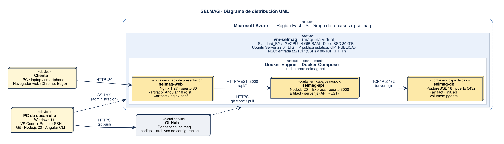

# SELMAG · E-commerce de tableros y materiales eléctricos

Proyecto del curso **Desarrollo y Soporte de Aplicaciones Multiplataforma** (CERTUS).
**Evidencia 2:** configuración de las herramientas para el soporte del proyecto web.

## Arquitectura (3 capas en Docker sobre Azure)

| Capa | Tecnología | Contenedor | Puerto |
|---|---|---|---|
| Presentación | Angular 18 servido por Nginx 1.27 | `selmag-web` | 80 (público) |
| Negocio | Node.js 20 + Express 4 (API REST) | `selmag-api` | 3000 (red interna) |
| Datos | PostgreSQL 16 | `selmag-db` | 5432 (red interna) |

Servidor: **vm-selmag**, máquina virtual de Azure con Ubuntu Server 24.04 LTS, Standard_D2alds_v7 (2 vCPU, 4 GiB de RAM), disco de 30 GiB, región East US e IP pública 52.152.141.180.



## Archivos de configuración

| Archivo | Para qué sirve |
|---|---|
| `docker-compose.yml` | Define los 3 contenedores, la red interna `selmag-net` y el volumen `pgdata` |
| `.env.example` | Variables de la base de datos (el `.env` real no se sube) |
| `frontend/Dockerfile` | Compila Angular y lo sirve con Nginx |
| `frontend/nginx.conf` | Servidor web y proxy inverso `/api/` → backend |
| `backend/Dockerfile` | Imagen de la API Node.js |
| `database/init.sql` | Tablas y datos iniciales de PostgreSQL |
| `infra/01-crear-vm-azure.sh` | Crea la VM, la IP pública y las reglas NSG |
| `infra/02-instalar-docker.sh` | Instala Docker, Docker Compose y Git en la VM |
| `infra/03-desplegar.sh` | Descarga el código de GitHub y levanta los contenedores |
| `infra/ssh_config.example` | Conexión remota por SSH / VS Code Remote-SSH |

## Despliegue paso a paso

1. **Crear la VM** (Azure Cloud Shell): `bash infra/01-crear-vm-azure.sh`
2. **Conectarse**: `ssh azureuser@<IP>` (o VS Code → Remote-SSH → `vm-selmag`)
3. **Clonar el repositorio e instalar Docker** en la VM:
   ```bash
   sudo apt-get update && sudo apt-get install -y git
   git clone https://github.com/<tu-usuario>/selmag.git
   bash selmag/infra/02-instalar-docker.sh
   exit    # vuelve a conectarte para que se aplique el permiso de docker
   ```
4. **Configurar las variables**:
   ```bash
   cd selmag
   cp .env.example .env && nano .env   # cambia la contraseña
   ```
5. **Publicar**: `bash infra/03-desplegar.sh`
6. **Probar**: abre `http://<IP>` en el navegador y `http://<IP>/api/health`

## Endpoints de la API

- `GET /api/health`: estado de la API y de la base de datos
- `GET /api/categorias`: categorías con la cantidad de productos
- `GET /api/productos?q=tablero&categoria=tableros`: lista y búsqueda
- `GET /api/productos/:sku`: detalle por código (pedido rápido)

## Comandos útiles en la VM

```bash
docker compose ps                 # estado de los contenedores
docker compose logs -f backend    # logs de la API
docker exec -it selmag-db psql -U selmag_app -d selmag   # consola SQL
docker compose down               # detener (los datos quedan en el volumen)
```

## Despliegue alternativo en Kubernetes (k3s)

La carpeta `k8s/` tiene los manifiestos para desplegar las mismas 3 capas en Kubernetes:

| Archivo | Recursos |
|---|---|
| `k8s/00-namespace.yaml` | Namespace `selmag` |
| `k8s/10-postgres.yaml` | PersistentVolumeClaim `pgdata`, Deployment `db` (1 réplica), Service `db` (ClusterIP) |
| `k8s/20-backend.yaml` | Deployment `backend` (2 réplicas, probes en `/api/health`), Service `backend` (ClusterIP) |
| `k8s/30-frontend.yaml` | Deployment `frontend` (2 réplicas), Service `frontend` (LoadBalancer, puerto 80) |

La contraseña va en un **Secret** y el `init.sql` en un **ConfigMap**; los crea el script, no se suben a GitHub.

```bash
bash infra/04-kubernetes.sh        # instala k3s y despliega en Kubernetes
kubectl -n selmag get pods,svc      # ver el estado
bash infra/05-volver-a-compose.sh  # volver a Docker Compose
```
